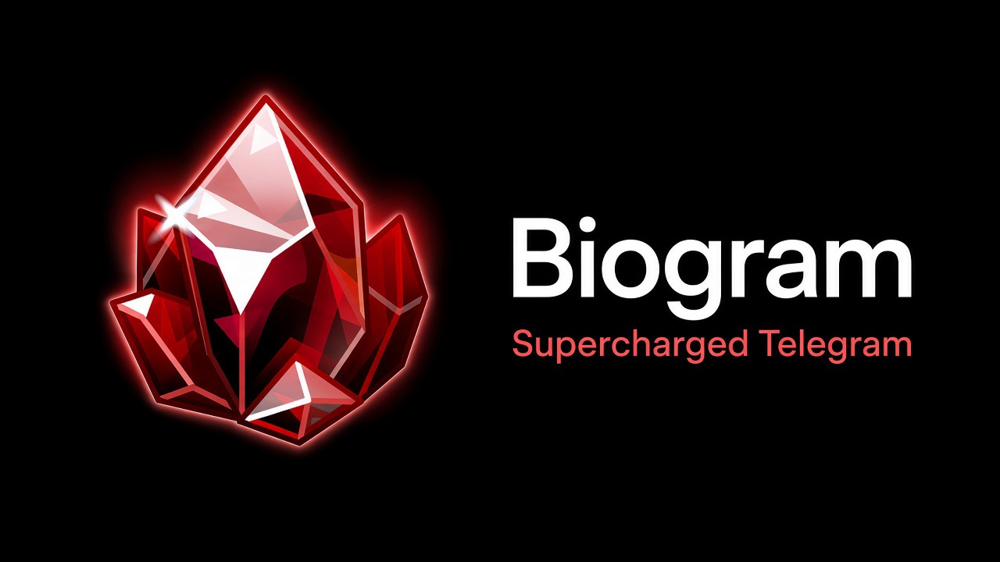
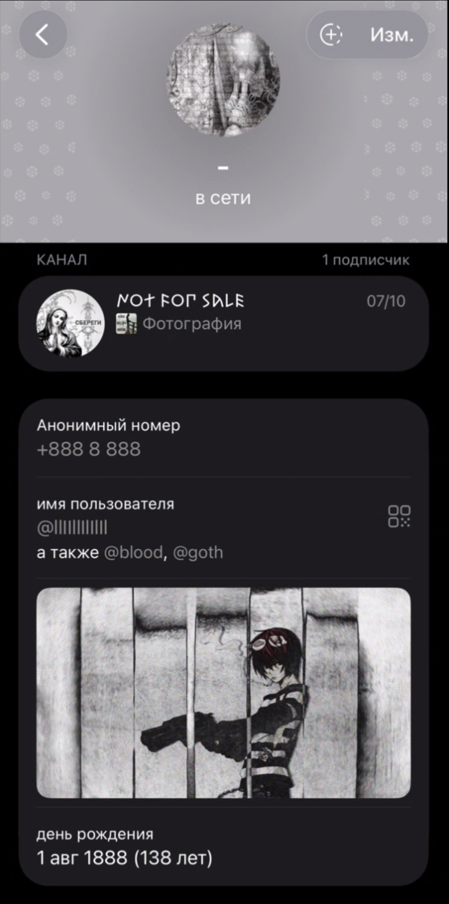
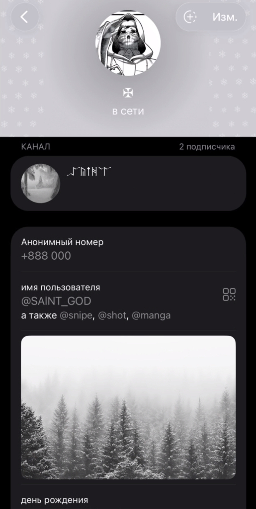
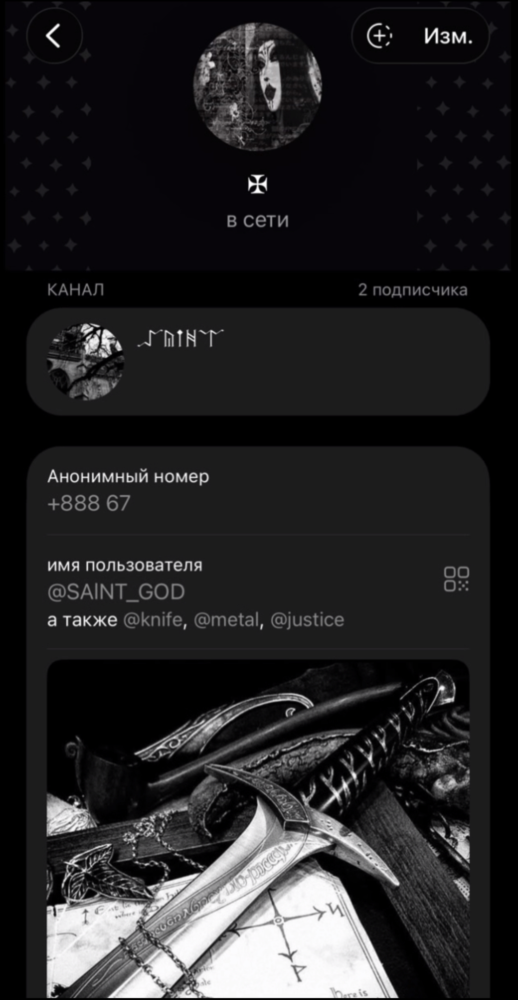
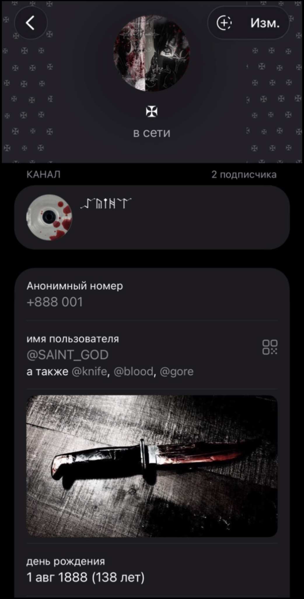
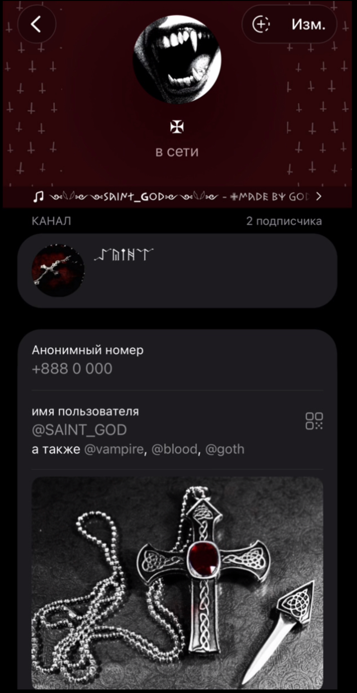
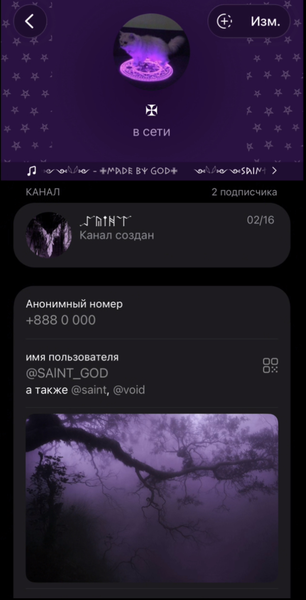

<!--
  Biogram — project overview
  Screenshots are stored in docs/ and referenced with repository-relative paths.
-->

<div align="center">

  

  <br />

  

  <h1>Biogram</h1>

  <p><strong>Your Telegram experience, with a more personal identity.</strong></p>

  <p>
    A community-maintained iOS client fork with profile customization,
    identity tools, and a growing set of native enhancements.
  </p>

  <p>
    <a href="https://github.com/b-1-o/Biogram">Repository</a>
    ·
    <a href="https://github.com/b-1-o/Biogram/tree/main/docs">Documentation</a>
    ·
    <a href="https://github.com/b-1-o/Biogram/issues">Issues</a>
  </p>

</div>

---

## Overview

**Biogram** is an iOS messaging client project built on a Telegram-derived codebase. It combines the underlying messaging application with a separate Biogram layer for personal profile presentation and account-level customization.

The goal is to make a profile feel more individual without turning the app into a collection of unrelated features. Biogram-specific settings are organized in one place, while the core messaging experience remains based on the upstream application.

## What makes Biogram different

### Profile appearance

- **Custom profile colors** — choose from built-in color presets and adjust brightness.
- **Decorative patterns** — add a repeating visual pattern to supported profile surfaces.
- **Profile banners** — choose a personal image and display it as a profile cover.
- **Per-account settings** — Biogram customization data is stored separately for each Telegram account on the device.

### Identity and profile tools

- **Aliases** — keep additional usernames/aliases in your Biogram profile settings.
- **Virtual / anonymous number entries** — manage locally stored number labels and values in the Biogram settings interface. These entries do not provision a phone number or provide a phone-number service.
- **Collectibles** — keep a personal collection of supported collectible entries, including entries added from a Telegram gift link.
- **Local Premium presentation** — control the local Premium-style presentation options exposed by Biogram. This does not grant a Telegram Premium subscription or change Telegram account entitlements.

### Native messaging improvements

Biogram also contains work in the underlying iOS client, including:

- A structured rich-text composer model.
- A native rich-text editing path with formatting and structured content support.
- Rich message rendering for content such as headings, lists, tables, formulas, and nested quotations.
- Progressive reveal support for streamed rich-text content.
- iOS 26 startup and re-signing compatibility improvements.

Some editor functionality is controlled by development/debug configuration. Availability can differ between build configurations; see the technical notes before treating experimental paths as production-ready.

## Screenshots

A closer look at Biogram across six screens. The gallery is arranged in **two rows of three**; every image keeps its original aspect ratio and scales to the available column width without cropping or stretching.

<table>
  <tr>
    <td width="33.33%" align="center"></td>
    <td width="33.33%" align="center"></td>
    <td width="33.33%" align="center"></td>
  </tr>
  <tr>
    <td width="33.33%" align="center"></td>
    <td width="33.33%" align="center"></td>
    <td width="33.33%" align="center"></td>
  </tr>
</table>

## Project status and data behavior

Biogram-specific customization data currently uses **on-device storage**. The app keeps a separate local data set for each Telegram account, including profile customization settings, aliases, virtual-number entries, collectibles, and banner metadata.

This means:

- Customization data is available on the device where it was created.
- It is not currently a guarantee of cross-device synchronization.
- Local profile settings should not be assumed to be publicly visible to other Biogram users.
- Removing the app or its local application data may remove locally stored customization data.

A future shared-profile or cloud-sync implementation would need a server-backed profile service and an explicit public-data model. The current local storage implementation should not be mistaken for that service.

## Technology

| Area | Implementation |
| --- | --- |
| Platform | iOS |
| Primary language | Swift |
| UI frameworks | UIKit, AsyncDisplayKit / Texture, project-native UI components |
| Build system | Bazel, invoked through the repository's `build-system/Make/Make.py` wrapper |
| Project configuration | Xcode project and Bazel build configuration |
| Local Biogram persistence | Codable models and JSON files in Application Support |
| UI testing | XCTest / XCUITest |

The repository contains the main application, supporting modules, third-party dependencies, build configuration, and project documentation.

## Repository layout

| Path | Purpose |
| --- | --- |
| `Telegram/` | Main application code and Biogram-specific application integration |
| `Telegram/Biogram/` | Biogram models, storage, state manager, banner and pattern helpers |
| `Swiftgram/` | Additional settings and UI integration |
| `submodules/` | Shared application modules and supporting libraries |
| `third-party/` | Third-party dependencies |
| `Tests/` | Test-related project files |
| `docs/` | Screenshots and technical documentation |
| `build-system/` | Build scripts and configuration |

## Build from source

Biogram is a source project rather than a one-click downloadable app. A working iOS development environment and the repository's build configuration are required.

### Requirements

- macOS
- Xcode and its matching iOS SDK
- Apple's command-line developer tools
- Git
- Python 3
- The repository's Bazel build dependencies and configuration
- A valid development signing setup for device builds

### Get the source

```bash
git clone https://github.com/b-1-o/Biogram.git
cd Biogram
```

If your checkout uses Git submodules, initialize them before building:

```bash
git submodule update --init --recursive
```

### Inspect the build options

The project uses the Make.py wrapper around Bazel. Start by checking the available options:

```bash
python3 build-system/Make/Make.py --help
```

The repository's maintainer build notes in [CLAUDE.md](CLAUDE.md) contain the current full build invocation, configuration path, signing requirements, and simulator workflow. Device builds require a correctly configured signing environment; do not commit signing credentials, certificates, or provisioning profiles to the repository.

### Run UI tests

The documented UI test scheme can be run with Xcode:

```bash
xcodebuild test \
  -project Telegram/Telegram.xcodeproj \
  -scheme iOSAppUITestSuite \
  -destination 'platform=iOS Simulator,name=iPhone 17,OS=26.1'
```

Use an iOS Simulator runtime and device that are installed in your Xcode environment. Available simulators can be listed with:

```bash
xcrun simctl list devices available
```

UI tests launch with an isolated test data directory and Telegram test servers. They are intended for testing and should not be used for personal accounts or important data. See [docs/ui-testing.md](docs/ui-testing.md) for the test environment and authoring conventions.

## Technical documentation

The `docs/` directory contains deeper implementation notes:

- [Rich-text composer](docs/richtext-composer.md) — editor integration, the `ChatInputContent` model, formatting, drafts, and send/edit behavior.
- [InstantPage rich-text rendering](docs/instantpage-richtext.md) — structured message rendering, streaming reveal, layout, and rendering invariants.
- [UI testing](docs/ui-testing.md) — running and writing iOS UI tests.
- [iOS 26 sideloading notes](IOS26_SIDELOAD.md) — startup behavior and App Group fallback handling.
- [Maintainer build notes](CLAUDE.md) — Bazel workflow, build configuration, and development guidance.

## Privacy and security

- Biogram's custom profile data is stored locally by the current implementation.
- Do not put API keys, signing credentials, provisioning profiles, private certificates, or personal account data in source control.
- Treat test-server accounts as disposable test data.
- Review any future cloud or public-profile integration carefully before storing or exposing profile information.

## Project direction

Biogram is being developed as a focused extension of the iOS messaging experience. The priorities are:

1. Make profile customization reliable and easy to understand.
2. Keep account-specific data isolated and predictable.
3. Preserve compatibility with the underlying messaging application.
4. Improve native editing, rendering, and overall iOS integration.
5. Clearly distinguish local-only features from features that are synchronized or publicly shared.

## Contributing

Bug reports, reproducible issues, and focused improvements are welcome.

Before opening an issue:

1. Check whether the issue is already reported.
2. Include your iOS version, device/simulator, and Biogram build or commit.
3. Describe the steps to reproduce the behavior.
4. Remove phone numbers, login codes, tokens, private messages, and other personal information from logs or screenshots.

For code changes, keep modifications scoped, follow the existing Swift conventions, and update the relevant technical documentation when behavior or architecture changes.

## Credits and project identity

Biogram builds on a Telegram-derived iOS codebase and incorporates upstream components and third-party libraries. Their respective authors retain ownership of their work and applicable licenses.

**Biogram is an independent community project and is not an official Telegram product.** Telegram and related names and marks belong to their respective owners.

---

<div align="center">
  <sub>Built with care for a more personal messaging experience.</sub>
</div>
